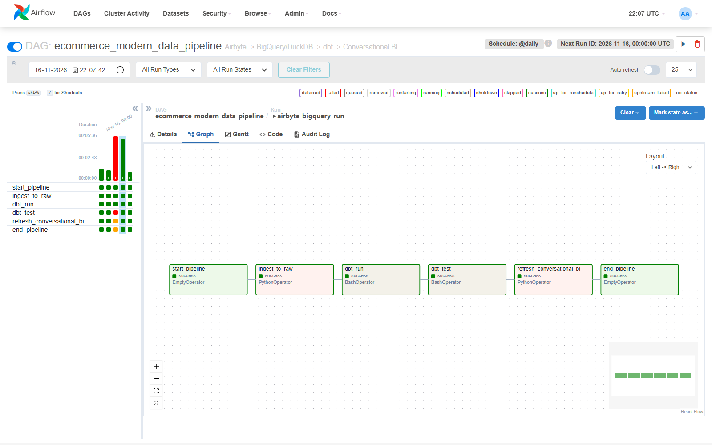
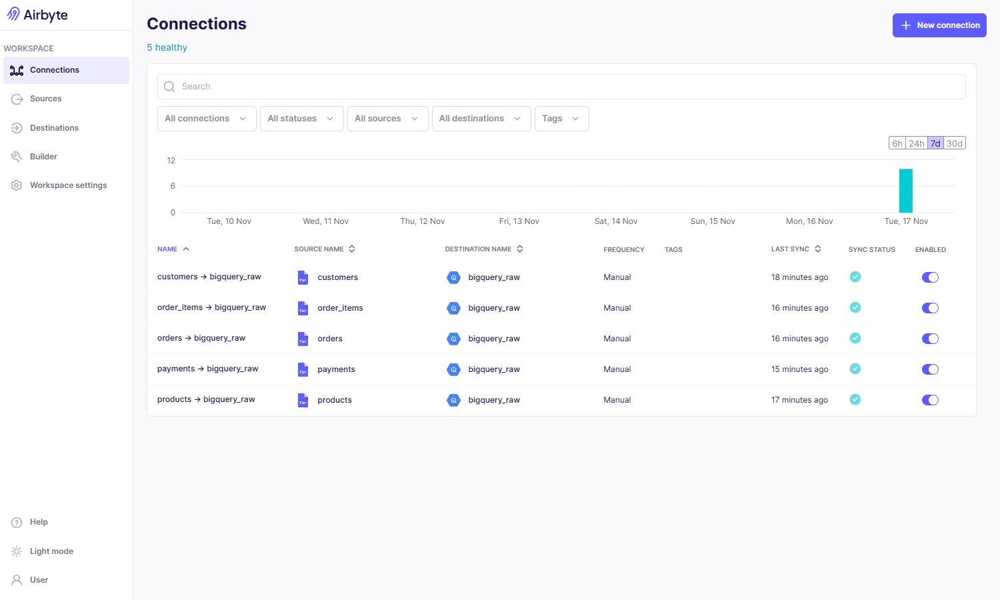
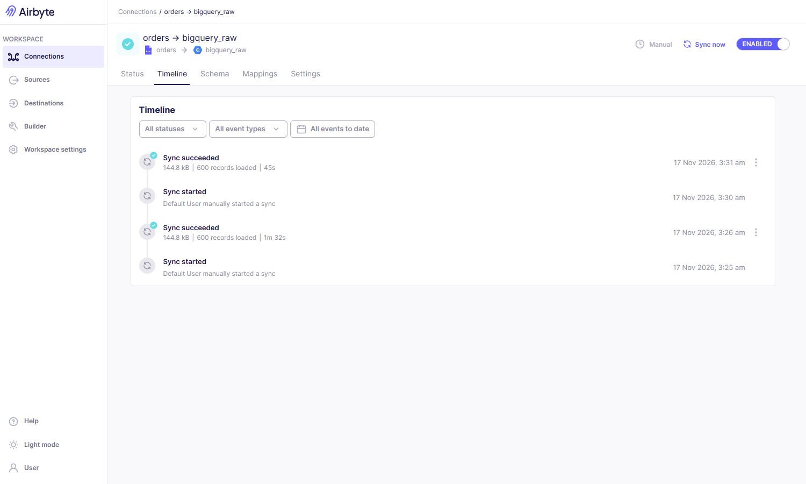
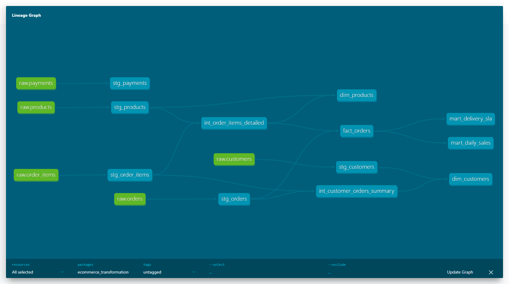
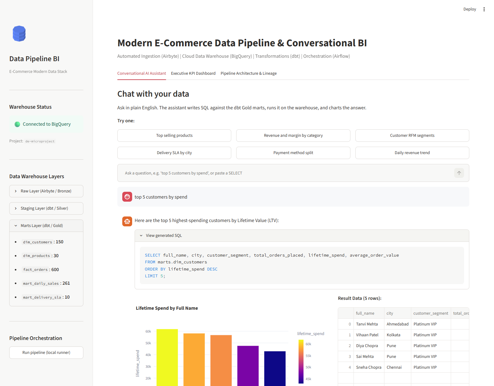
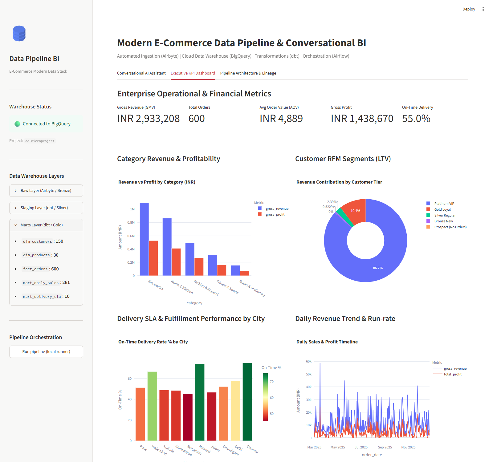

# Modern E-Commerce Data Pipeline & Conversational BI

[](https://www.python.org/downloads/)
[](https://airflow.apache.org/)
[](https://cloud.google.com/bigquery)
[](https://www.getdbt.com/)
[](https://streamlit.io/)

A complete, enterprise-grade **Modern Data Stack (MDS)** pipeline built for e-commerce transactional analytics. Demonstrates automated data extraction, cloud data warehousing, dimensional star schema modeling with quality test gates, automated DAG orchestration, and an AI-powered **Conversational BI Interface** allowing users to query data insights in plain English.

---

## 1. Architecture Overview

```
                                MODERN DATA STACK ARCHITECTURE
                                
  ┌───────────────────────┐
  │  Transactional Source │  Customers, Products, Orders, Order Items, Payments
  └──────────┬────────────┘
             │
             ▼  [EXTRACT & LOAD]
  ┌───────────────────────┐
  │  Airbyte Connector    │  Airbyte sync triggered by Airflow (or local CSV loader fallback)
  └──────────┬────────────┘
             │
             ▼  [DATA WAREHOUSE LANDING ZONE]
  ┌───────────────────────┐
  │ Warehouse: RAW Layer  │  BigQuery dataset `raw` (Immutable, source-of-truth)
  └──────────┬────────────┘
             │
             ▼  [TRANSFORMATION: BRONZE]
  ┌───────────────────────┐
  │  dbt Staging Models   │  stg_customers, stg_products, stg_orders, stg_payments
  └──────────┬────────────┘
             │
             ▼  [TRANSFORMATION: SILVER]
  ┌───────────────────────┐
  │ dbt Intermediate      │  int_order_items_detailed (COGS & Margins), int_customer_orders
  └──────────┬────────────┘
             │
             ▼  [TRANSFORMATION: GOLD - STAR SCHEMA]
  ┌───────────────────────┐
  │  dbt Business Marts   │  dim_customers (RFM Tiers), dim_products, fact_orders, mart_sla
  └──────────┬────────────┘
             │
             ▼  [ORCHESTRATION & QUALITY GATES]
  ┌───────────────────────┐
  │  Apache Airflow DAG   │  Scheduled pipeline, task dependencies, dbt test assertions
  └──────────┬────────────┘
             │
             ▼  [CONSUMPTION & REPORTING]
  ┌───────────────────────┐
  │   Conversational BI   │  Natural Language to SQL, Plotly Visualizations, Executive KPIs
  └───────────────────────┘
```

---

## 2. Key Tech Stack Components

| Layer | Technology | Purpose & Implementation |
| :--- | :--- | :--- |
| **Orchestration** | **Apache Airflow** | Schedules DAG, triggers ingestion, executes dbt runs & quality tests, and notifies BI layer. |
| **Ingestion (EL)** | **Airbyte / Connector** | Extracts raw source data and loads into the BigQuery `raw` dataset without destructive mutations. |
| **Warehouse** | **BigQuery** (local DuckDB as an offline fallback) | Cloud warehouse with `raw`, `staging` and `marts` datasets. |
| **Transformations** | **dbt (Data Build Tool)** | Multi-layer Medallion modeling (Bronze Staging -> Silver Intermediate -> Gold Dimensional Star Schema). |
| **Quality Testing** | **dbt Test Suite** | 26 `dbt test` checks (unique, not_null, accepted_values) defined in `schema.yml`; a failure blocks the BI refresh. |
| **Conversational BI** | **Streamlit + Plotly** | Web dashboard featuring Natural Language to SQL translation, auto-generated Plotly charts, and executive KPI cards. |

---

## 3. Dimensional Data Model (Star Schema)

The transformation layer models raw transactional data into an analytics-ready dimensional model:

```
                        ┌─────────────────────────┐
                        │      DIM_CUSTOMERS      │
                        ├─────────────────────────┤
                        │ PK customer_id          │
                        │    full_name            │
                        │    city, state          │
                        │    total_orders_placed  │
                        │    lifetime_spend (LTV) │
                        │    customer_segment     │
                        └────────────┬────────────┘
                                     │ 1
                                     │
                                     │ N
┌─────────────────────────┐     ┌────┴────────────────────┐     ┌─────────────────────────┐
│      DIM_PRODUCTS       │     │       FACT_ORDERS       │     │     MART_DELIVERY_SLA   │
├─────────────────────────┤     ├─────────────────────────┤     ├─────────────────────────┤
│ PK product_id           │ 1   │ PK order_id             │     │ PK shipping_city        │
│    product_name         ├─────┤ FK customer_id          │     │    total_orders         │
│    category             │ N   │    order_date           │     │    delayed_orders       │
│    retail_price_inr     │     │    order_status         │     │    on_time_rate_pct     │
│    unit_cost_inr        │     │    order_total_amount   │     │    avg_delivery_days    │
│    total_quantity_sold  │     │    total_cogs_amount    │     └─────────────────────────┘
│    gross_margin_pct     │     │    net_gross_profit     │
└─────────────────────────┘     │    is_delayed_flag      │
                                │    delivery_delay_days  │
                                └─────────────────────────┘
```

---

## 4. Quick Start Guide (5 Minutes)

### Step 1: Install dependencies
```bash
cd DEproject
python3 -m venv .venv && source .venv/bin/activate       # Windows PowerShell: python -m venv .venv; .\.venv\Scripts\Activate.ps1
pip install -r requirements.txt
```
Python 3.10+ (tested with 3.12 on Windows 11). `requirements.txt` pins `pandas<3` because DuckDB 1.1 cannot read pandas 3 string columns.

### Step 2: Choose the warehouse
By default everything runs on a local DuckDB file (`warehouse.duckdb`, created by the pipeline). To use **BigQuery** (free sandbox, no credit card):
1. Create a Google Cloud project at console.cloud.google.com (do not add billing) and note the **project ID**.
2. Authenticate, either way:
   - **Service-account key (no gcloud needed):** IAM -> Service accounts -> create one with roles *BigQuery Data Editor* and *BigQuery Job User* -> Keys -> Add key -> JSON. Save it outside the repo.
   - or `gcloud auth application-default login`.
3. Set the variables (see `.env.example`):
   ```bash
   export GCP_PROJECT=your-project-id
   export GOOGLE_APPLICATION_CREDENTIALS=/absolute/path/to/key.json   # skip if you used gcloud
   ```
   The pipeline and BI app switch to BigQuery automatically (datasets `raw`, `staging`, `marts` are created for you).

> The free BigQuery sandbox blocks DML and expires tables after 60 days. The pipeline only uses load jobs and `CREATE ... AS SELECT`, so it is designed to work there.

### Step 3: Run the pipeline
**Without Airflow** (local runner, same tasks and order as the DAG):
```bash
python orchestration/local_runner.py
```
This runs: `ingest_to_raw` -> `dbt run` (12 models) -> `dbt test` (26 tests) -> `refresh_conversational_bi`.

**With Airflow** (real scheduler + UI, needs Docker):
```bash
cd orchestration
echo "AIRFLOW_UID=$(id -u)" > .env          # Linux/macOS. On Windows use AIRFLOW_UID=50000
# add the variables below for BigQuery, then:
docker compose up --build airflow-init && docker compose up -d
```
For BigQuery put the key file in `orchestration/secrets/gcp-key.json` (git-ignored) and add to `orchestration/.env`:
`DBT_TARGET=bigquery`, `GCP_PROJECT=your-project-id`, `AIRFLOW_GCP_KEY=/opt/airflow/secrets/gcp-key.json`.
For Airbyte add `AIRBYTE_URL=http://host.docker.internal:8000`, `AIRBYTE_CLIENT_ID`, `AIRBYTE_CLIENT_SECRET` (from `abctl local credentials`) and `AIRBYTE_CONNECTION_ID=<id1>,<id2>,<id3>,<id4>,<id5>`.
Open http://localhost:8080 (admin/admin) and trigger `ecommerce_modern_data_pipeline`.

**Ingestion mode:** if `AIRBYTE_CONNECTION_ID` is set, the ingest task triggers a real Airbyte sync for each connection (see `ingestion/airbyte_setup_guide.md`). If not, it falls back to a simple CSV loader (`bigquery_ingest.py` or the local DuckDB loader) standing in for Airbyte. If `SKIP_INGEST=1`, ingestion is skipped entirely (see "Running without Airbyte on a small machine").

### Step 4: Launch the Conversational BI Web App
```bash
streamlit run bi_interface/app.py
```
Open your browser at `http://localhost:8501`.

### Running without Airbyte on a small machine
Airbyte (abctl) runs a whole Kubernetes cluster inside Docker; give Docker Desktop at least 12 GB for it. That is too much for an 8 GB laptop that also has to run Airflow. Load the raw data once on a bigger machine (or before the demo), then run everything else without Airbyte:

1. Make sure the BigQuery `raw` dataset already holds the Airbyte-loaded tables (`customers`, `products`, `orders`, `order_items`, `payments`).
2. Set `SKIP_INGEST=1` (in `orchestration/.env` for Airflow, or in your shell for `local_runner.py` / the BI app's runner button).
3. Run Airflow/dbt as usual. The `ingest_to_raw` task prints `SKIP_INGEST is set: skipping ingestion entirely...` and finishes at once. It neither starts Airbyte nor runs the fallback CSV loader, so the Airbyte-loaded `raw` data is not overwritten; `dbt_run`, `dbt_test` and `refresh_conversational_bi` then run on it.

Without `SKIP_INGEST` and without `AIRBYTE_CONNECTION_ID`, the fallback loader would **overwrite** `raw.*` with its own load (same rows, but no Airbyte columns). Unset `SKIP_INGEST` (or leave it empty) to get the normal behaviour back. The flag was verified both through `orchestration/local_runner.py` (DuckDB) and through an Airflow DAG run on BigQuery (raw tables untouched). It was **not** tested on a macOS machine with 8 GB of RAM.
---

## 4b. Verification status (what was actually run)

Verified on 2026-11-17 on Windows 11 with Docker Desktop (23 GB RAM), Python 3.12, Airbyte (abctl v0.30.4), Airflow 2.9.2 (Docker), dbt-core 1.8.10, and the free BigQuery sandbox project `de-microproject` (no billing, location US).

| Component | What was run and verified |
| :--- | :--- |
| **Airbyte** | Installed with `abctl local install --no-browser --insecure-cookies`. Created a BigQuery destination (standard inserts, dataset `raw`), 5 "File (CSV)" sources (HTTPS public web) and 5 connections (manual schedule, Full refresh \| Overwrite). All 5 syncs succeeded, both started by hand and triggered by Airflow, and loaded **150 / 30 / 600 / 1020 / 492** rows into `raw.customers / products / orders / order_items / payments`. The free sandbox did not block Airbyte's BigQuery destination. |
| **BigQuery** | `raw`, `staging`, `marts` datasets populated by Airbyte + dbt; `marts.pipeline_runs` written by the Airflow refresh task. |
| **dbt** | `dbt run` 12/12 and `dbt test` 26/26 on (a) Airbyte-loaded BigQuery tables, (b) BigQuery tables from the fallback CSV loader, (c) local DuckDB. The staging models needed no changes for Airbyte's column types (dates arrive as STRING, numbers as NUMERIC). Mart aggregates (600 orders, GMV 2,933,208) are identical between the Airbyte-loaded BigQuery data and DuckDB. |
| **Airflow** | In Docker: a manual run of `ecommerce_modern_data_pipeline` with Airbyte configured went green on all 6 tasks (the ingest task triggered the 5 Airbyte jobs, `dbt_run` built 12 models, `dbt_test` passed 26, `refresh_conversational_bi` wrote `marts.pipeline_runs`). Also green with the fallback loader, and with `SKIP_INGEST=1`. A temporary always-failing dbt test made `dbt_test` fail (after its retries) and left `refresh_conversational_bi` and `end_pipeline` as `upstream_failed`; the test was removed afterwards. |
| **Conversational BI** | `streamlit run bi_interface/app.py` against BigQuery, checked in a browser: sidebar shows "Connected to BigQuery" with row counts; all 6 sample chips answer; the free-typed question "top 5 customers by spend" returns 5 rows; "View generated SQL" works; the KPI dashboard and the lineage/catalog tab render. |
| **Unit tests** | `python -m unittest tests.test_pipeline`: 5/5 on DuckDB and 5/5 on BigQuery. |

**Not verified (treat as untested):** macOS and the 8 GB MacBook; `abctl --low-resource-mode`; the Airflow DAG running in Docker against the DuckDB target (this was only seen on an earlier machine, not re-run here); the LLM text-to-SQL path (`ANTHROPIC_API_KEY`); the BI sidebar's "Run pipeline (local runner)" button; Airbyte Cloud and Fivetran (Snowflake was removed from the project); the Airflow `@daily` schedule beyond one catch-up run; the failing-test gate was demonstrated on a run that used the fallback loader, not on an Airbyte-ingest run.

**Requirement for the Airbyte sources:** Airbyte's File source downloads the CSVs from a URL. The URLs used here are `https://raw.githubusercontent.com/gauravv-jainn/depro/main/DEproject/data_source/raw_data/<table>.csv`, so that repo has to be public (a private repo returns 404 and the sync cannot even discover the schema). If you fork it, change the owner/repo in those URLs.

### Screenshots

| | |
| :--- | :--- |
| **Airflow DAG graph (all tasks green)** |  |
| **Airbyte connections** |  |
| **Airbyte sync history** |  |
| **dbt docs lineage graph** |  |
| **BI chat answering a question** |  |
| **BI KPI dashboard** |  |

---

## 5. Conversational BI Features

1. **Natural Language to SQL**:
   - Ask: *"What are the top 10 products by revenue?"*
   - Ask: *"Show customer spend distribution by RFM segment"*
   - Ask: *"Which shipping cities have the highest delivery delay rate?"*
   - Ask: *"What is our daily gross revenue trend?"*
2. **Automatic Chart Rendering**:
   - Selects Bar, Line, Pie/Donut, or Data Table depending on query dimensions.
3. **Executive KPI Dashboard**:
   - Real-time Gross Merchandise Value (GMV), Total Orders, Average Order Value (AOV), On-Time Delivery Rate %, Gross Profit.
4. **Data Lineage & Catalog**:
   - Interactive schema inspector with row counts and sample records across all layers.

---

## 6. Project Directory Structure

```
DEproject/
│
├── README.md                          # Project documentation & presentation guide
├── requirements.txt                   # Python dependencies
├── pipeline_tasks.py                  # Task functions shared by the DAG and local runner
├── warehouse_config.py                # Chooses bigquery / duckdb from env vars
├── .env.example                       # Warehouse & API credentials template
│
├── data_source/                       # Raw data generation
│   ├── generate_raw_data.py           # Realistic transactional e-commerce dataset generator
│   └── raw_data/                      # Generated CSV files (customers, products, orders, items, payments)
│
├── ingestion/                         # Airbyte / Ingestion layer
│   ├── airbyte_setup_guide.md         # Airbyte Cloud / OSS setup documentation
│   ├── airbyte_trigger.py             # Triggers real Airbyte syncs via its API
│   ├── bigquery_ingest.py             # Fallback CSV loader for BigQuery
│   └── local_ingest.py                # Fallback CSV loader for local DuckDB
│
│
├── dbt_ecommerce/                     # Complete dbt project (Medallion Architecture)
│   ├── dbt_project.yml                # dbt project configuration
│   ├── run_dbt_models.py              # Wrapper around the real `dbt run` / `dbt test` CLI
│   ├── profiles.yml                   # dbt profile: duckdb (default) or bigquery
│   ├── macros/generate_schema_name.sql
│   ├── models/sources.yml             # raw.* sources
│   └── models/
│       ├── staging/                   # Bronze Layer (Cleaning, casting, renaming)
│       │   ├── stg_customers.sql
│       │   ├── stg_products.sql
│       │   ├── stg_orders.sql
│       │   ├── stg_order_items.sql
│       │   ├── stg_payments.sql
│       │   └── schema.yml             # Staging tests and docs
│       ├── intermediate/              # Silver Layer (Enriched joins & margins)
│       │   ├── int_order_items_detailed.sql
│       │   └── int_customer_orders_summary.sql
│       └── marts/                     # Gold Layer (Dimensional Star Schema)
│           ├── dim_customers.sql      # RFM tiers and Customer Lifetime Value (LTV)
│           ├── dim_products.sql       # Catalog profitability & sales volume
│           ├── fact_orders.sql        # Core sales & delivery SLA fact table
│           ├── mart_daily_sales.sql   # Time-series revenue aggregation
│           ├── mart_delivery_sla.sql  # Logistics fulfillment performance by city
│           └── schema.yml             # Gold tests and documentation
│
├── orchestration/                     # Pipeline Orchestration
│   ├── docker-compose.yaml            # Airflow (LocalExecutor + Postgres) Docker setup
│   ├── Dockerfile                     # Airflow image with dbt in its own venv
│   ├── dags/
│   │   └── ecommerce_etl_dag.py       # Apache Airflow DAG definition
│   └── local_runner.py                # Runs the DAG's tasks without an Airflow server
│
├── bi_interface/                      # Conversational BI Interface (Streamlit)
│   ├── app.py                         # Streamlit application
│   ├── conversational_engine.py       # Natural language parser & Text-to-SQL engine
│   └── db_connector.py                # Unified BigQuery / local warehouse connector
│
├── docs/screenshots/                  # Screenshots referenced from this README
│
└── tests/                             # Automated Test Suite
    └── test_pipeline.py               # Unit & integration regression tests 
```

---

## 7. Viva & External Examiner Guide

### Frequently Asked Questions (FAQ)

**Q1: Why did you choose ELT instead of traditional ETL?**
> *Answer:* In modern cloud data warehouses like BigQuery, compute is elastic, cheap, and decoupled from storage. With ELT (Extract, Load, Transform), we load raw, unmutated data into BigQuery's `raw` dataset first using Airbyte. Transformations are then performed inside the warehouse using `dbt` in SQL, providing version control, lineage tracking, idempotency, and full auditability without losing raw historical data.

**Q2: What is the Medallion Architecture you used in dbt?**
> *Answer:* We organized data into three distinct layers:
> 1. **Bronze (Staging)**: Cleans column names, casts timestamps and numeric types, and filters deleted/null keys.
> 2. **Silver (Intermediate)**: Joins order items with product costs to calculate COGS, gross margins, and customer order aggregates.
> 3. **Gold (Marts)**: Models business-ready star schema dimensions (`dim_customers`, `dim_products`) and fact tables (`fact_orders`, `mart_daily_sales`, `mart_delivery_sla`).

**Q3: How does Apache Airflow handle pipeline failures?**
> *Answer:* In our DAG (`ecommerce_modern_data_pipeline`), we configured task retries (`retries=2`, `retry_delay=2 min`) and quality gates. If the ingestion task or any dbt data quality test fails, downstream tasks (`refresh_conversational_bi`) are blocked, preventing corrupted data from reaching the BI dashboard.

**Q4: How does the Conversational BI Interface work?**
> *Answer:* The interface uses a rule-based intent parser mapping natural language phrases (like "top products", "RFM customer tiers", "delivery delay rate") to SQL against the Gold Marts. If `ANTHROPIC_API_KEY` (or `OPENAI_API_KEY`) is set, unmatched questions are sent to an LLM for text-to-SQL. The results are queried via the database connector and dynamically visualized using Plotly charts.

---

## 8. Suggested Team Workload Distribution (2 Members)

| Team Member | Primary Responsibilities |
| :--- | :--- |
| **Member 1 (Data Pipeline & Warehouse Lead)** | - Ingestion layer with Airbyte / EL connector.<br>- BigQuery project, service account and dataset setup.<br>- Apache Airflow DAG configuration, retry policies, and orchestration logic. |
| **Member 2 (Analytics Engineering & BI Lead)** | - dbt Medallion modeling (Bronze, Silver, Gold star schema).<br>- dbt schema tests (`unique`, `not_null`, `accepted_values`).<br>- Streamlit Conversational BI interface & Plotly dashboard implementation. |
